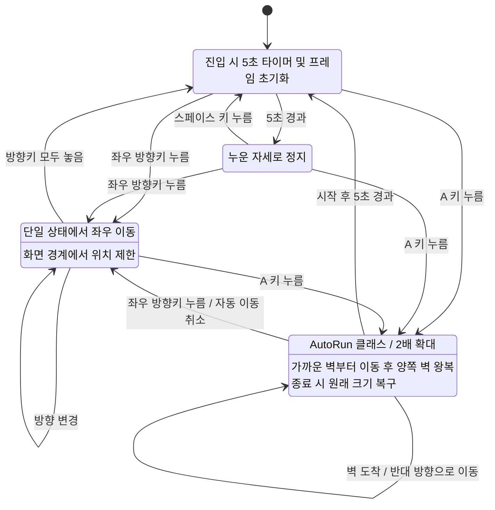

# Boy 상태 다이어그램

IDLE에 진입할 때마다 5초 타이머를 새로 시작합니다.
RUN은 좌우 공통 상태이며 `face_dir`로 방향을 구분합니다.
방향키를 모두 놓으면 IDLE로 돌아갑니다.
양쪽 방향키를 누르면 마지막에 누른 방향을 우선합니다.
SLEEP에서도 IDLE과 같은 방향키 처리로 RUN에 진입합니다.
A는 IDLE, SLEEP, RUN에서 동작하며 AUTORUN 중 다시 눌러도 타이머를 초기화하지 않습니다.
양쪽 벽까지 거리가 같으면 왼쪽 벽으로 먼저 이동합니다.
확대 시에도 캐릭터 전체가 화면 안에 있도록 위치를 제한합니다.
AUTORUN에서 방향키를 놓는 것만으로 취소되지 않으며, 방향키를 누르면 RUN으로 전환합니다.
자동 이동 종료 후 IDLE의 5초 수면 타이머를 새로 시작합니다.
